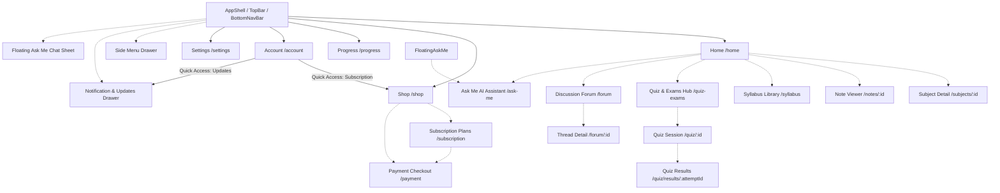

# SomaSmart Flutter — Navigation Map

### Bottom Navigation Tabs (5 canonical mobile destinations):
1. **Home (`/home`)**: Approved homepage (Hero, Active Days, Quick Access Cards, Ask Me shortcut).
2. **Shop (`/shop`)**: Plans, pricing packages, membership status, and book store catalog.
3. **Progress (`/progress`)**: Student study statistics and analytics.
4. **Account (`/account`)**: User profile, editable contact information, verified email, sign out.
5. **Settings (`/settings`)**: Theme, language, notification preferences, terms & policies.

### Deep / Push Routes (Above Shell):
- **Subscription**: `/subscription`
- **Payment Checkout**: `/payment`
- **Subjects**: `/subjects`, `/subjects/:id`
- **Notes**: `/notes/:id`
- **Syllabus**: `/syllabus`
- **Quizzes & Exams**: `/quiz-exams` (with `?tab=topic|exam|practice|timed`), `/exams`
- **Quiz Session**: `/quiz/:id`
- **Quiz Results**: `/quiz/results/:attemptId` (supports `offline` query parameters)
- **Discussion Forum**: `/forum`
- **Thread Detail**: `/forum/:id`
- **Ask Me**: `/ask-me`
